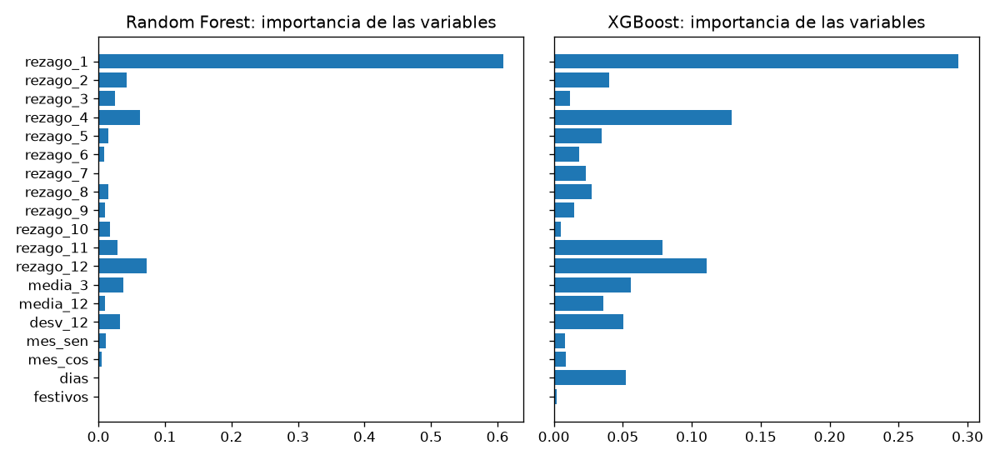
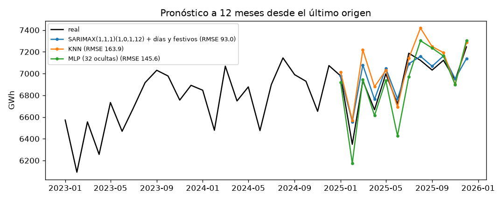
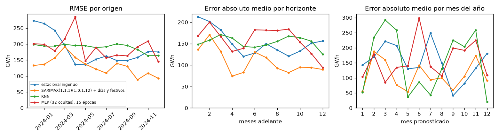

# Informe del miniproyecto 2

**Demanda mensual de energía eléctrica de Colombia (GWh), 2015-2025:
aprendizaje automático y profundo contra el SARIMAX del miniproyecto 1.**
Las cifras de este informe son las que imprime `python miniproyecto.py` y
las figuras son las que ese guion deja en `figuras/`. Las tablas de apoyo
quedan en `resultados/`.

## 1. La serie y el modelo a superar

La serie es la misma del miniproyecto 1: la **demanda real de energía
eléctrica del Sistema Interconectado Nacional de Colombia**, en GWh por mes,
publicada por XM. Va de 2015-01 a 2025-12, 132 observaciones sin huecos (la
ficha está en `datos/README.md`). La preparación también es la misma:
`preparar` deja una interpolación lineal por si el CSV cambiara, que hoy no
toca ningún valor, y **se conservan los atípicos** de abril-junio de 2020
(cuarentena) y mayo de 2021 (paro), porque son demanda real y quedan fuera
de los 24 meses de prueba.


El *backtest* es el de `comun.py`, sin modificar: 13 orígenes, de 2023-12 a
2024-12, cada uno con 12 pronósticos, sobre la ventana 2024-01 a 2025-12.

**El modelo a superar** es el mejor del miniproyecto 1, un
$\text{SARIMAX}(1,1,1)(1,0,1)_{12}$ con dos exógenas de calendario, los días
del mes y los festivos de Colombia, ajustado sobre la serie dividida entre
10:

$$y_t = \beta_1\,\text{dias}_t + \beta_2\,\text{festivos}_t + \eta_t,
\qquad (1 - \phi_1 B)(1 - \Phi_1 B^{12})(1 - B)\,\eta_t =
(1 + \theta_1 B)(1 + \Theta_1 B^{12})\,\varepsilon_t.$$

| Modelo | RMSE | MAE | MAPE (%) | Parámetros |
|---|---:|---:|---:|---:|
| SARIMAX(1,1,1)(1,0,1,12) + días y festivos | 131,11 | 108,09 | 1,59 | 7 |
| estacional ingenuo (el piso) | 182,26 | 153,20 | 2,22 | 0 |

**Las métricas coinciden con las del miniproyecto 1** (131,11, 108,08 y
1,59 %); el MAE sale 108,09 en Linux y 108,08 en el computador donde se
corrió el miniproyecto 1, una diferencia de redondeo entre máquinas. Las
cifras de este informe son las de Linux, que es donde corre la acción de
GitHub. Los 7 parámetros son $\beta_1$, $\beta_2$, $\phi_1$, $\theta_1$,
$\Phi_1$, $\Theta_1$ y $\sigma^2$; en el último origen, con 120 meses,
$\beta_1 = +180{,}4$ GWh por día del mes y $\beta_2 = -33{,}2$ GWh por
festivo.

**Qué cambió al trasladarlo.** Una sola cosa, y no cambia ninguna cifra: en
el miniproyecto 1 los festivos salían del paquete `holidays`, que aquí no
entra porque el guion solo usa las siete bibliotecas del enunciado. El guion
calcula ahora las mismas fechas con la regla (`festivos_del_anio`): seis
festivos de fecha fija, siete que la ley Emiliani pasa al lunes siguiente y
cinco que dependen de la Pascua. De 2015 a 2025 dan los mismos 17 o 18
festivos por año que `holidays`, y por eso el RMSE sale idéntico. Los
órdenes, la escala, la clase `ARIMA` de `statsmodels` y el reintento cuando
el optimizador no converge son los del miniproyecto 1.

## 2. La tabla supervisada

**Qué aprenden los modelos.** `OBJETIVO = "dif12"`: los modelos no aprenden
la demanda $y_t$ sino su diferencia con el mismo mes del año anterior,

$$z_t = y_t - y_{t-12}, \qquad \hat y_t = y_{t-12} + \hat z_t .$$

La razón es la tendencia: la serie crece 28 % en once años, y 8 de los 24
meses de prueba superan el máximo que había hasta 2023-12 (7 030 GWh). Un
KNN promedia vecinos y un árbol promedia hojas, así que ninguno puede
pronosticar un valor más alto que los que vio; la diferencia de 12 sí se
mueve en un rango que se repite (media 147 GWh, desviación 230). La decisión
no se tomó mirando la prueba: `comparar_objetivos` corre el *backtest* común
sobre la serie recortada a 2015-01 a 2023-12, con los cuatro modelos en sus
valores por defecto, y la diferencia gana en los cuatro
(`resultados/objetivo.csv`):

| Modelo (valores por defecto) | RMSE con `nivel` | RMSE con `dif12` |
|---|---:|---:|
| KNN | 352,11 | 180,14 |
| SVR | 717,34 | 163,69 |
| Random Forest | 371,51 | 242,83 |
| XGBoost | 362,93 | 306,90 |

Lo que se paga por la diferencia es un año de datos, y que la cuarentena
entra dos veces: como caída en 2020 ($z$ de $-633$ GWh en abril) y como
rebote en 2021 ($+785$ GWh en abril).

**Las columnas.** La fila del mes $t$ tiene 19 columnas, todas con lo que se
sabe antes de observar $z_t$:

| Columna | Fórmula |
|---|---|
| `rezago_k`, $k = 1, \dots, 12$ | $z_{t-k}$ |
| `media_3` | $\tfrac{1}{3}\sum_{k=1}^{3} z_{t-k}$ |
| `media_12` | $\bar z_{12} = \tfrac{1}{12}\sum_{k=1}^{12} z_{t-k}$ |
| `desv_12` | $\sqrt{\tfrac{1}{11}\sum_{k=1}^{12}\left(z_{t-k} - \bar z_{12}\right)^2}$ |
| `mes_sen`, `mes_cos` | $\sin(2\pi m_t/12)$ y $\cos(2\pi m_t/12)$, con $m_t$ el mes del año |
| `dias` | $\text{dias}_t - \text{dias}_{t-12}$ |
| `festivos` | $\text{festivos}_t - \text{festivos}_{t-12}$ |

Los rezagos salen de `z.shift(k)` y las ventanas se calculan sobre la serie
ya corrida un mes (`z.shift(1).rolling(...)`), así que terminan en $t-1$. El
mes va en seno y coseno para que diciembre quede junto a enero. Las dos
últimas son el calendario del SARIMAX, en la misma forma que el objetivo:
como $z_t$ es una diferencia de 12, lo que le sirve es cuánto cambió el
calendario frente al año anterior. `dias` vale $+1$ en el febrero bisiesto
de 2024 y $-1$ en el de 2025; `festivos` recoge la Semana Santa que cambia
de mes ($+2$ en marzo y $-2$ en abril de 2024, y al revés en 2025). Las dos
se conocen años antes y no dependen de la demanda. Después de perder 12
meses por la diferencia y 12 por los rezagos quedan **108 filas completas,
de 2017-01 a 2025-12**; en el último origen del *backtest* son 96.

**La prueba de que ninguna fila ve su mes.** `comprobar_sin_fuga` toma cada
uno de los 132 meses, le suma 1 000 GWh, rehace el objetivo y la tabla, y
exige que la fila de ese mes quede idéntica; si alguna cambia, lanza
`AssertionError` y el guion se detiene. Para saber que la prueba mide algo,
el guion hace dos controles: repite lo mismo con una tabla que tiene una
fuga a propósito (la media de 3 meses sin correr la serie, que incluye
$z_t$) y comprueba que la fila del mes siguiente sí cambia. Imprime:

```
tabla: 108 filas completas y 19 columnas, de 2017-01 a 2025-12; objetivo: dif12
8 de los 24 meses de prueba superan el máximo anterior (7030 GWh en 2023-09)
diferencia de 12: media 147.0 y desviación 230.2 GWh; media 2022: +207.5, 2023: +342.4, 2024: +187.2, 2025: +92.9
sin fuga: al alterar cada uno de los 132 meses, 0 filas propias cambian; con la tabla con fuga a propósito cambian 118
```

**El pronóstico recursivo.** El modelo solo sabe pronosticar un mes. Para
los 12 del horizonte, `recursivo` agrega el mes siguiente como vacío, arma
su fila con lo que hay hasta el mes anterior, pronostica $\hat z_t$, lo
devuelve al nivel con $\hat y_t = y_{t-12} + \hat z_t$ y lo escribe en la
serie como si fuera dato. En el paso siguiente ese pronóstico es el
`rezago_1`, y así hasta el mes 12, donde todos los rezagos del 1 al 11 son
pronósticos. Lo único del futuro que entra es el calendario. Por eso el
error de un paso se arrastra a los siguientes.

**El escalador.** Vive dentro de cada modelo y se ajusta en cada origen,
solo con las filas de entrenamiento de ese origen: en KNN y SVR es el
`StandardScaler` del `make_pipeline`, que se ajusta en `ajustado.fit(X, z)`
dentro de `con_tabla`; en las redes, `Red.fit` calcula la media y la
desviación de `X` y de `z` con lo que recibe. En la rejilla, el mismo
*pipeline* hace que se ajuste dentro de cada pliegue.

## 3. Aprendizaje automático

**La rejilla.** De dos a cuatro valores por hiperparámetro. Se busca con
`GridSearchCV` sobre la tabla armada con `serie.iloc[:-24]`, 84 filas de
2017-01 a 2023-12, con `TimeSeriesSplit` de 4 pliegues y 12 meses de
validación cada uno: se ajusta con 36, 48, 60 y 72 filas y se valida con
2020, 2021, 2022 y 2023. La validación siempre es posterior al ajuste.
**Ninguno de los 24 meses del *backtest* participa** porque se quitan antes
de armar la tabla: si eligieran el hiperparámetro, el RMSE de la tabla final
estaría medido sobre meses que el modelo, a través de su configuración, ya
vio (`resultados/hiperparametros.csv`).

| Modelo | Rejilla | Elegido | RMSE de validación | Peor de la rejilla |
|---|---|---|---:|---:|
| KNN | `n_neighbors` 3, 5, 9, 15 | 15 | 267,60 | 302,14 |
| SVR | `C` 10, 100, 1000; `epsilon` 1, 10, 50 | `C` 100, `epsilon` 10 | 275,01 | 313,16 |
| Random Forest | `max_depth` 3, 6, sin límite; `min_samples_leaf` 1, 3, 5 | `max_depth` 3, `min_samples_leaf` 1 | 265,07 | 272,39 |
| XGBoost | `max_depth` 2, 3, 5; `learning_rate` 0,03, 0,1, 0,3 | `max_depth` 2, `learning_rate` 0,3 | 267,13 | 297,14 |

El objetivo de la SVR no se escala, así que `C` y `epsilon` están en GWh.
Dos lecturas. Primera, en los cuatro gana la opción más simple de su
rejilla: el KNN con más vecinos y los árboles menos profundos. Con 36 a 72
filas, lo que valida mejor es promediar mucho. Segunda, los RMSE de
validación (265 a 275) son mucho más altos que los del *backtest* y casi
iguales entre modelos, porque dos de los cuatro pliegues son 2020 y 2021, la
caída y el rebote de la cuarentena, que ningún modelo podía anticipar.



**Importancia.** En los dos ensambles manda `rezago_1`: 0,608 en Random
Forest y 0,293 en XGBoost. Siguen `rezago_12` (0,072) y `rezago_4` (0,062)
en Random Forest, y `rezago_4` (0,129), `rezago_12` (0,111) y `rezago_11`
(0,079) en XGBoost. Coincide con la PACF del miniproyecto 1 en lo
principal: allí los rezagos más fuertes eran el 1 ($-0{,}62$) y el 12
($+0{,}31$). La comparación no es exacta, porque esa PACF era de la
diferencia regular y aquí los rezagos son de la diferencia de 12. El
`rezago_1` de $z$ dice que el crecimiento interanual del mes pasado es la
mejor pista del de este mes, y el `rezago_12` es la memoria anual que el
SARIMAX lleva en $\Phi_1$ y $\Theta_1$. El `rezago_4` no aparecía destacado
en la PACF y no tiene una explicación de calendario: con 108 filas puede ser
ruido. Las variables de calendario pesan poco (`dias` 0,052 en XGBoost y
0,001 en Random Forest; `festivos` 0,002 o menos en los dos), y es lo
esperado: después de la diferencia de 12 solo son distintas de cero en los
bisiestos y cuando la Semana Santa cambia de mes, unas pocas filas. En el
SARIMAX, que trabaja en nivel, `dias` era la exógena que más aportaba.

**Los cuatro en el *backtest*.**

| Modelo | RMSE | MAE | MAPE (%) |
|---|---:|---:|---:|
| KNN | 189,40 | 153,33 | 2,26 |
| SVR | 190,24 | 161,56 | 2,38 |
| Random Forest | 241,16 | 205,69 | 3,01 |
| XGBoost | 277,69 | 245,44 | 3,59 |

Gana el **KNN**, casi empatado con la SVR, y los dos ensambles de árboles
quedan de últimos. Ninguno supera al SARIMAX (131,11) ni al estacional
ingenuo (182,26). El orden es el de la sencillez: un KNN de 15 vecinos
pronostica casi el promedio de las diferencias que ha visto, y eso es
estable al encadenar 12 pasos. En XGBoost el error absoluto medio sube de
162 GWh a un mes a 256 GWh a doce meses (`resultados/error_por_horizonte.csv`):
el pronóstico recursivo le devuelve como rezagos sus propios errores, y un
árbol que parte por umbrales cambia de hoja con ellos.

## 4. Aprendizaje profundo

**Las redes.** Son las tres que pide el enunciado y una cuarta, el MLP
corto. Todas se entrenan con la clase `Red`: Adam con tasa
0,01, pérdida MSE, todos los datos a la vez, semilla fija (2026) y entrada y
salida escaladas con el entrenamiento del origen.

| Red | Arquitectura | Entrada | Parámetros |
|---|---|---|---:|
| MLP | 19 → 32 (ReLU) → 1 | las 19 columnas de la tabla, sueltas | 673 |
| MLP corto | 6 → 32 (ReLU) → 1 | 6 de las 19 columnas: `rezago_1`, `rezago_12`, `mes_sen`, `mes_cos`, `dias` y `festivos` | 257 |
| LSTM | `nn.LSTM` de una capa con 16 unidades y una capa lineal sobre el último estado oculto | los 12 rezagos como secuencia $(\text{lote}, 12, 1)$, del más viejo al más reciente | 1 233 |
| Conv1D | `nn.Conv1d` de 8 filtros con núcleo 3 (ReLU) y una capa lineal sobre las $8 \times 10$ salidas | la misma secuencia de 12 rezagos | 113 |

El MLP tiene $19 \cdot 32 + 32 + 32 + 1 = 673$ parámetros; la LSTM,
$4\,(1 \cdot 16 + 16 \cdot 16 + 2 \cdot 16) + 17 = 1\,233$; la Conv1D,
$8 \cdot 3 + 8 + 80 + 1 = 113$; el MLP corto, $6 \cdot 32 + 32 + 32 + 1 =
257$. Las dos redes de secuencia solo ven los rezagos: no reciben el mes,
las ventanas ni el calendario.

**La tercera red es una Conv1D.** Se eligió por el tamaño de la serie: cada
filtro mira tres meses seguidos y se desliza por los doce, así que los
mismos pesos sirven para cualquier trimestre y la red queda en 113
parámetros, la más pequeña de las tres, para 96 filas. Un Transformer
tendría varias veces más parámetros que filas, y un híbrido sobre los
residuos del SARIMAX tenía poco que aprender: en el miniproyecto 1 esos
residuos pasaron Ljung-Box como ruido blanco.

**El MLP corto** es una cuarta red que se agregó al ver las curvas de
pérdida. Es el mismo MLP, pero de las 19 columnas de la tabla solo lee
seis: los dos rezagos que usa el SARIMAX (el 1 y el 12, los de la PACF del
miniproyecto 1), el mes y el calendario. La tabla no cambia. La pregunta
que responde es si el sobreajuste del MLP viene de darle doce rezagos y
tres ventanas, muy parecidos entre sí, con tan pocas filas.


**Validación.** Tabla con `serie.iloc[:-24]`; se entrena con 72 filas, hasta
2022-12, y se valida con las 12 de 2023, todas anteriores al *backtest*.
Cada candidata se entrena 300 épocas y se queda con la época de menor
pérdida de validación (`resultados/validacion_redes.csv`, pérdida sobre el
objetivo escalado). Para leer la escala: pronosticar siempre la media del
entrenamiento da 1,100 (la línea punteada horizontal de la figura), repetir
la diferencia del mes anterior da 0,455 y suponer crecimiento cero, que es
el estacional ingenuo, da 2,456.

| Candidata | Parámetros | Época elegida | Validación en esa época | Entrenamiento en esa época | Validación en la época 300 | Entrenamiento en la época 300 |
|---|---:|---:|---:|---:|---:|---:|
| MLP (8 ocultas) | 169 | 12 | 0,604 | 0,477 | 2,625 | 0,002 |
| MLP (16 ocultas) | 337 | 10 | 0,532 | 0,534 | 3,349 | 0,000 |
| **MLP (32 ocultas)** | 673 | **15** | **0,515** | 0,344 | 3,386 | 0,000 |
| MLP corto (8 ocultas) | 65 | 95 | 0,415 | 0,306 | 0,527 | 0,154 |
| **MLP corto (32 ocultas)** | 257 | **273** | **0,355** | 0,024 | 0,373 | 0,020 |
| LSTM (16 ocultas) | 1 233 | 59 | 0,359 | 0,306 | 2,672 | 0,045 |
| Conv1D (8 filtros) | 113 | 72 | 0,514 | 0,200 | 2,827 | 0,047 |

**Lectura de las curvas.** En las redes que reciben muchas entradas el
sobreajuste empieza casi de inmediato. En los tres MLP de 19 columnas la
validación toca fondo entre las épocas 10 y 15 y desde ahí sube, mientras
el entrenamiento sigue bajando hasta cero: en la época 300 el MLP de 32
tiene pérdida de entrenamiento 0,000 y de validación 3,386, más de seis
veces su mínimo y peor que pronosticar crecimiento cero (2,456). La red se
aprendió las 72 filas de memoria. La LSTM y la Conv1D, que reciben los 12
rezagos, tardan más (épocas 59 y 72) y terminan igual, en 2,7 y 2,8. Por
eso ninguna se entrena hasta el final: cada una entra al *backtest* con las
épocas de su mínimo, la línea punteada vertical.

El MLP corto muestra de dónde viene el sobreajuste. Con las mismas 32
neuronas y solo 6 entradas, la validación baja a 0,355 y se queda ahí
(0,373 en la época 300): no hay rebote, aunque tiene 257 parámetros para 72
filas. Lo que le permite a la red memorizar no es tanto el número de
parámetros como el número de entradas: doce rezagos y tres ventanas que
dicen casi lo mismo. Con 6 entradas el mínimo es mejor que repetir el mes
anterior (0,455); con 19, peor (0,515).

Quedan, de cada familia, la de menor pérdida de validación: **MLP de 32
ocultas con 15 épocas**, **MLP corto de 32 ocultas con 273 épocas**, **LSTM
con 59** y **Conv1D con 72**. Entre los tres tamaños del MLP la diferencia
es pequeña (0,604, 0,532 y 0,515) frente a lo que cambia una red con otra
semilla, como se ve abajo.

**Las cuatro en el *backtest*.**

| Red | RMSE | MAE | MAPE (%) |
|---|---:|---:|---:|
| MLP (32 ocultas), 15 épocas | 188,33 | 159,03 | 2,33 |
| LSTM (16 ocultas), 59 épocas | 208,00 | 181,22 | 2,66 |
| MLP corto (32 ocultas), 273 épocas | 216,92 | 170,63 | 2,48 |
| Conv1D (8 filtros), 72 épocas | 223,23 | 191,06 | 2,81 |

**Una curva de pérdida sana no dio un mejor pronóstico a 12 meses.** El MLP
corto y la LSTM tuvieron las mejores validaciones (0,355 y 0,359) y quedan
por detrás del MLP de 19 columnas, el de peor validación de los cuatro. La
razón es qué mide cada cosa: la validación mide un mes adelante con rezagos
reales, y el *backtest* mide doce meses encadenando pronósticos. El MLP
corto es de hecho el mejor de toda la tabla a un mes, con error absoluto
medio de 130,8 GWh contra 136,1 del SARIMAX, pero a doce meses llega a
176,6 contra 89,8 (`resultados/error_por_horizonte.csv`): su entrada
principal es `rezago_1`, y desde el segundo paso ese rezago es su propio
pronóstico.

**La mejor red con cinco semillas.** El MLP de 32 ocultas y 15 épocas, cada
semilla por el *backtest* completo (`resultados/semillas.csv`):

| Semilla | RMSE | MAE | MAPE (%) |
|---:|---:|---:|---:|
| 2026 | 188,33 | 159,03 | 2,33 |
| 2027 | 169,37 | 143,29 | 2,11 |
| 2028 | 150,39 | 121,78 | 1,78 |
| 2029 | 128,07 | 107,49 | 1,56 |
| 2030 | 131,68 | 105,58 | 1,54 |

**Media 153,57 GWh y desviación 25,48 GWh**, de 128,07 a 188,33. La
diferencia entre la media del MLP y el SARIMAX es $153{,}57 - 131{,}11 =
22{,}46$ GWh, **menor que la desviación entre semillas**. Con estas cinco
corridas no se puede afirmar que el MLP sea peor que el SARIMAX: una
semilla (2029) queda por debajo y otra (2030) empata. Tampoco se puede
afirmar que sea igual de bueno: la semilla de la tabla, la 2026, es la
peor de las cinco, y entre la mejor y la peor hay 60 GWh. Con 15 épocas la
red casi no se aleja de sus pesos iniciales, así que el resultado depende
de dónde arrancó. El SARIMAX da 131,11 todas las veces.

## 5. La tabla y la elección

`resultados/metricas.csv`, ordenada por RMSE:

| Modelo | RMSE | MAE | MAPE (%) | Parámetros | Segundos |
|---|---:|---:|---:|---:|---:|
| SARIMAX(1,1,1)(1,0,1,12) + días y festivos | **131,11** | **108,09** | **1,59** | 7 | 7,7 |
| estacional ingenuo | 182,26 | 153,20 | 2,22 | 0 | 0,0 |
| MLP (32 ocultas), 15 épocas | 188,33 | 159,03 | 2,33 | 673 | 1,1 |
| KNN | 189,40 | 153,33 | 2,26 | 1 824 | 1,1 |
| SVR | 190,24 | 161,56 | 2,38 | 1 841 | 1,0 |
| LSTM (16 ocultas), 59 épocas | 208,00 | 181,22 | 2,66 | 1 233 | 2,4 |
| MLP corto (32 ocultas), 273 épocas | 216,92 | 170,63 | 2,48 | 257 | 2,6 |
| Conv1D (8 filtros), 72 épocas | 223,23 | 191,06 | 2,81 | 113 | 1,6 |
| Random Forest | 241,16 | 205,69 | 3,01 | 1 436 | 3,2 |
| XGBoost | 277,69 | 245,44 | 3,59 | 1 372 | 1,4 |

Los segundos son los del *backtest* completo de cada modelo (13 ajustes) y
cambian de una máquina a otra. **Ninguno de los ocho modelos nuevos supera
al SARIMAX, y con la semilla de la tabla ninguno supera tampoco al
estacional ingenuo.**



**A qué se debe, con datos de la serie.**

*1. La serie cambió de ritmo justo en la ventana de prueba.* Los modelos
nuevos aprenden la diferencia interanual $z_t$, y esa diferencia fue en
promedio de **$+207{,}5$ GWh en 2022 y $+342{,}4$ en 2023**, los dos años
más recientes del entrenamiento, y de **$+187{,}2$ en 2024 y $+92{,}9$ en
2025**, los de prueba. Un modelo que
aprendió cuánto crecía la demanda pronostica de más cuando el crecimiento
se frena. Se ve en el sesgo, el promedio de pronóstico menos real sobre los
156 pronósticos de cada modelo (`resultados/errores.csv`):

| Modelo | Sesgo (GWh) | Mes que peor pronostica | MAE en ese mes (GWh) | Peor origen | RMSE en ese origen |
|---|---:|---|---:|---|---:|
| SARIMAX | $+34{,}8$ | febrero | 187,6 | 2024-03 | 191,3 |
| estacional ingenuo | $-81{,}5$ | julio | 248,7 | 2023-12 | 273,2 |
| KNN | $+104{,}0$ | marzo | 292,1 | 2024-08 | 200,6 |
| SVR | $+116{,}4$ | marzo | 289,2 | 2024-04 | 222,1 |
| Random Forest | $+85{,}4$ | noviembre | 298,3 | 2024-04 | 287,0 |
| XGBoost | $+81{,}1$ | noviembre | 354,6 | 2024-03 | 374,2 |
| MLP | $+15{,}8$ | junio | 298,8 | 2024-04 | 284,8 |
| MLP corto | $+69{,}9$ | marzo | 377,4 | 2024-12 | 300,8 |
| LSTM | $+120{,}2$ | noviembre | 264,6 | 2024-03 | 345,4 |
| Conv1D | $+115{,}0$ | febrero | 349,5 | 2023-12 | 317,1 |

Siete de los ocho modelos nuevos pronostican entre 70 y 120 GWh de más. El
estacional ingenuo, que supone crecimiento cero, se queda 81,5 GWh corto: el
crecimiento real quedó entre lo uno y lo otro. El SARIMAX también se pasa,
pero solo 34,8 GWh, porque su diferencia regular se corrige con el último
dato en cada origen. El peor origen de la SVR, los dos
ensambles de árboles, el MLP y la LSTM es 2024-03 o 2024-04, los mismos
donde ya fallaba el SARIMAX en el miniproyecto 1, cuando la demanda venía
de crecer 7,8 % interanual y se frenó.



*2. Hay pocos meses para lo que se les pide aprender.* En el último origen
hay 120 meses y, tras la diferencia y los rezagos, **96 filas**. El SARIMAX
ajusta 7 parámetros con 120 meses, unos 17 meses por parámetro. El MLP
ajusta 673 con 96 filas y la LSTM 1 233: entre 7 y 13 parámetros por fila.
La curva de pérdida lo muestra: con 19 entradas la validación empieza a
subir en la época 15 y la red lleva el error de entrenamiento a cero. Pero
el sobreajuste no es toda la explicación. El MLP corto no se sobreajusta en
la validación y pierde igual en el *backtest* (216,92), y la Conv1D, con
113 parámetros, también (223,23). Corregir la curva no corrigió el
pronóstico: lo que les falta no se arregla con menos entradas ni con menos
parámetros, sino con más años que muestren un cambio de ritmo como el de
2024.

*3. El calendario se pierde con la diferencia de 12.* El SARIMAX trabaja en
nivel y `dias` le dice cada mes cuántos días tiene. En la tabla, `dias` y
`festivos` son diferencias con el año anterior y casi siempre valen cero.
Por eso marzo, donde cae o no la Semana Santa, es el peor mes del KNN (MAE
292,1 GWh), de la SVR (289,2) y del MLP corto (377,4), contra 159,9 del
SARIMAX, y febrero es el peor de la Conv1D (349,5), que no recibe el
calendario. El MLP corto sí recibe `festivos`, pero en la tabla solo hay
unos pocos marzos y abriles con la Semana Santa cambiada de mes para
aprender cuánto pesa.

*4. La variación entre semillas es del tamaño de la diferencia.* La mejor
red cambia 25,48 GWh de desviación con solo cambiar la semilla, más que los
22,46 GWh que separan su media del SARIMAX (sección 4).

## 6. Conclusión

**El modelo que se pondría en uso es el clásico: el
SARIMAX$(1,1,1)(1,0,1)_{12}$ con días del mes y festivos**, RMSE 131,11
GWh, MAE 108,09 GWh y MAPE 1,59 %. Frente a él, la mejor alternativa en la
tabla, el MLP, queda 57,2 GWh arriba en RMSE (188,33), y en promedio sobre
cinco semillas, 22,5 GWh arriba (153,57).

Lo que se paga por cada lado:

| | SARIMAX | MLP (la mejor red) | KNN (el mejor de aprendizaje automático) |
|---|---|---|---|
| Datos | Usa los 120 meses del origen; 7 parámetros | Pierde 24 meses por la diferencia y los rezagos: 96 filas para 673 parámetros | 96 filas; guarda las 96 × 19 = 1 824 cifras de la tabla |
| Tiempo del *backtest* | 7,7 s | 1,1 s | 1,1 s |
| Qué tanto se explica | Cada coeficiente se lee: un día más de mes son unos 180 GWh, un festivo unos 33 menos, y $\Phi_1$ es la memoria anual | No se lee: 673 pesos, y el pronóstico cambia con la semilla (de 128 a 188 GWh de RMSE) | Se puede mostrar a qué 15 meses pasados se parece el mes, pero no por qué |
| Se repite | Siempre da 131,11 | Desviación de 25,5 GWh entre semillas | Siempre da 189,40 |

Elegir el SARIMAX cuesta lo único en que pierde, el tiempo: 7,7 segundos
contra cerca de uno, que para un pronóstico mensual no pesa. A cambio da el
menor error, usa todos los meses, no depende de una semilla y sus
coeficientes se le pueden explicar a quien use el pronóstico.

El resultado no dice que las redes no sirvan para esta serie, sino que con
132 meses no hay con qué ajustarlas. Dos de las cinco semillas del MLP
quedan a la altura del SARIMAX (128,07 y 131,68), así que promediar varias
semillas sería lo siguiente por probar. Lo que ya se probó y no alcanzó fue
quitarle entradas a la red: el MLP corto deja de sobreajustarse y pronostica
mejor que el SARIMAX a un mes, pero no a doce. Con lo medido aquí, y con el
mismo *backtest* para todos, el modelo clásico sigue siendo el mejor.
