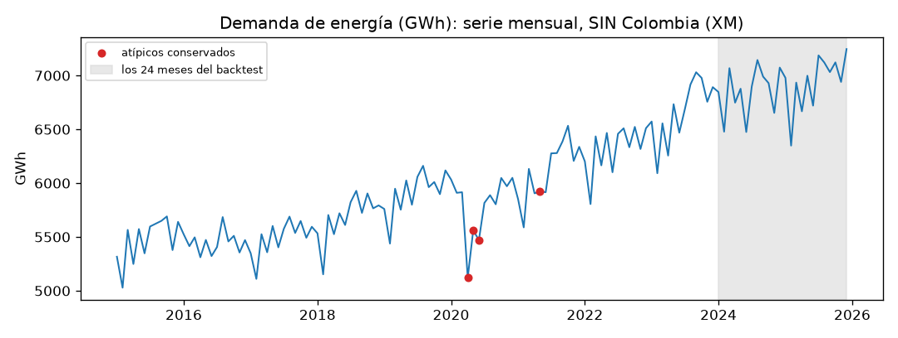
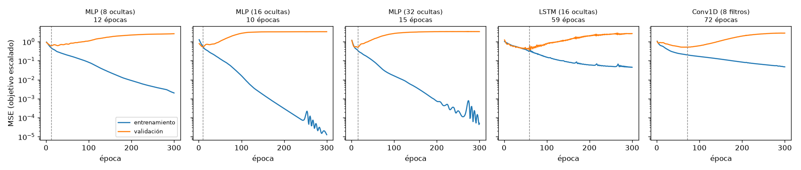

# Informe del miniproyecto 2

**Demanda mensual de energía eléctrica de Colombia (GWh), 2015-2025:
aprendizaje automático y profundo contra el SARIMAX del miniproyecto 1.**

**Resultado:** ningún modelo nuevo supera al SARIMAX (RMSE 131,11 GWh). El
mejor, un MLP, da 188,33 con la semilla de la tabla y 153,57 en promedio
sobre cinco semillas. La causa principal es que el crecimiento de la demanda
se frenó justo en los meses de prueba.

Las cifras son las que imprime `python miniproyecto.py` en Linux, que es
donde corre la acción de GitHub; las figuras son las de `figuras/` y las
tablas de apoyo están en `resultados/`.

## 1. La serie y el modelo a superar

| | |
|---|---|
| Serie | Demanda real de energía del Sistema Interconectado Nacional de Colombia, GWh por mes, publicada por XM (ficha en `datos/README.md`) |
| Periodo | 2015-01 a 2025-12, 132 observaciones |
| Huecos | Ninguno; `preparar` deja una interpolación lineal que hoy no toca ningún valor |
| Atípicos | Se conservan abril-junio de 2020 (cuarentena) y mayo de 2021 (paro): son demanda real y quedan fuera de los 24 meses de prueba |
| *Backtest* | El de `comun.py`, sin modificar: 13 orígenes (2023-12 a 2024-12), 12 pronósticos cada uno, sobre 2024-01 a 2025-12 |

Serie y preparación son las del miniproyecto 1.



**El modelo a superar** es el mejor del miniproyecto 1: un
$\text{SARIMAX}(1,1,1)(1,0,1)_{12}$ con los días del mes y los festivos de
Colombia como exógenas, ajustado sobre la serie dividida entre 10.

$$y_t = \beta_1\,\text{dias}_t + \beta_2\,\text{festivos}_t + \eta_t,
\qquad (1 - \phi_1 B)(1 - \Phi_1 B^{12})(1 - B)\,\eta_t =
(1 + \theta_1 B)(1 + \Theta_1 B^{12})\,\varepsilon_t.$$

| Modelo | RMSE | MAE | MAPE (%) | Parámetros |
|---|---:|---:|---:|---:|
| SARIMAX(1,1,1)(1,0,1,12) + días y festivos | 131,11 | 108,09 | 1,59 | 7 |
| estacional ingenuo (el piso) | 182,26 | 153,20 | 2,22 | 0 |

- **Coincide con el miniproyecto 1** (131,11, 108,08 y 1,59 %). El MAE sale
  108,09 en Linux y 108,08 en el computador del miniproyecto 1: es redondeo
  entre máquinas.
- **Los 7 parámetros** son $\beta_1$, $\beta_2$, $\phi_1$, $\theta_1$,
  $\Phi_1$, $\Theta_1$ y $\sigma^2$. En el último origen (120 meses),
  $\beta_1 = +180{,}4$ GWh por día del mes y $\beta_2 = -33{,}2$ GWh por
  festivo.
- **Qué cambió al trasladarlo:** solo de dónde salen los festivos. El
  paquete `holidays` no está entre las siete bibliotecas permitidas, así
  que el guion calcula las mismas fechas con la regla (`festivos_del_anio`:
  seis de fecha fija, siete que la ley Emiliani pasa al lunes y cinco que
  dependen de la Pascua). De 2015 a 2025 dan los mismos 17 o 18 festivos
  por año, y por eso el RMSE es idéntico. Órdenes, escala, clase `ARIMA` y
  reintento de convergencia son los del miniproyecto 1.

## 2. La tabla supervisada

### Qué aprenden los modelos

`OBJETIVO = "dif12"`: la diferencia con el mismo mes del año anterior, no
la demanda.

$$z_t = y_t - y_{t-12}, \qquad \hat y_t = y_{t-12} + \hat z_t .$$

La decisión se midió sin tocar la prueba: `comparar_objetivos` corre el
*backtest* común sobre la serie recortada a 2015-01 a 2023-12, con los
cuatro modelos en sus valores por defecto (`resultados/objetivo.csv`).

| Modelo (valores por defecto) | RMSE con `nivel` | RMSE con `dif12` |
|---|---:|---:|
| KNN | 352,11 | 180,14 |
| SVR | 717,34 | 163,69 |
| Random Forest | 371,51 | 242,83 |
| XGBoost | 362,93 | 306,90 |

- **La diferencia gana en los cuatro**, y en KNN y SVR baja el error a la
  mitad o menos.
- **Por qué:** la serie crece 28 % en once años y 8 de los 24 meses de
  prueba superan el máximo anterior (7 030 GWh, en 2023-09). Un KNN o un
  árbol promedian valores vistos y no pueden pronosticar por encima de
  ellos. La diferencia sí se mueve en un rango que se repite (media 147
  GWh, desviación 230).
- **Lo que cuesta:** un año de datos, y que la cuarentena entra dos veces,
  como caída en 2020 ($z = -633$ GWh en abril) y como rebote en 2021
  ($+785$ GWh en abril).

### Las columnas

La fila del mes $t$ tiene 19 columnas, todas conocidas antes de observar
$z_t$.

| Columna | Fórmula | Cómo evita ver $z_t$ |
|---|---|---|
| `rezago_k`, $k = 1, \dots, 12$ | $z_{t-k}$ | `z.shift(k)` |
| `media_3` | $\tfrac{1}{3}\sum_{k=1}^{3} z_{t-k}$ | ventana sobre `z.shift(1)` |
| `media_12` | $\bar z_{12} = \tfrac{1}{12}\sum_{k=1}^{12} z_{t-k}$ | ventana sobre `z.shift(1)` |
| `desv_12` | $\sqrt{\tfrac{1}{11}\sum_{k=1}^{12}\left(z_{t-k} - \bar z_{12}\right)^2}$ | ventana sobre `z.shift(1)` |
| `mes_sen`, `mes_cos` | $\sin(2\pi m_t/12)$, $\cos(2\pi m_t/12)$, con $m_t$ el mes del año | solo depende de la fecha |
| `dias` | $\text{dias}_t - \text{dias}_{t-12}$ | calendario, conocido años antes |
| `festivos` | $\text{festivos}_t - \text{festivos}_{t-12}$ | calendario, conocido años antes |

- **Filas:** tras perder 12 meses por la diferencia y 12 por los rezagos
  quedan 108, de 2017-01 a 2025-12; en el último origen del *backtest* son
  96.
- **El calendario va como diferencia**, igual que el objetivo. `dias` vale
  $+1$ en febrero de 2024 (bisiesto) y $-1$ en febrero de 2025; `festivos`
  vale $+2$ en marzo y $-2$ en abril de 2024, y al revés en 2025, por la
  Semana Santa. El resto de los meses casi siempre es cero.

### La prueba de que ninguna fila ve su mes

`comprobar_sin_fuga` suma 1 000 GWh a cada uno de los 132 meses, rehace el
objetivo y la tabla, y exige que la fila de ese mes quede idéntica; si
alguna cambia, lanza `AssertionError` y el guion se detiene. El guion
imprime:

```
tabla: 108 filas completas y 19 columnas, de 2017-01 a 2025-12; objetivo: dif12
8 de los 24 meses de prueba superan el máximo anterior (7030 GWh en 2023-09)
diferencia de 12: media 147.0 y desviación 230.2 GWh; media 2022: +207.5, 2023: +342.4, 2024: +187.2, 2025: +92.9
sin fuga: al alterar cada uno de los 132 meses, 0 filas propias cambian; con la tabla con fuga a propósito cambian 118
```

| Comprobación | Resultado | Qué demuestra |
|---|---:|---|
| Filas propias que cambian con la tabla del guion | 0 de 132 | Ninguna fila usa su propio mes |
| Filas propias que cambian con una tabla con fuga a propósito (`media_3` sin correr la serie) | 118 de 132 | La prueba detecta una fuga cuando la hay |
| La fila del mes siguiente | cambia | La prueba mide algo: $z_t$ sí entra en la fila $t+1$ |

### Pronóstico recursivo y escalador

| | Cómo se hace | Consecuencia |
|---|---|---|
| Pronóstico a 12 meses | `recursivo` agrega el mes siguiente vacío, arma su fila, pronostica $\hat z_t$, lo devuelve al nivel con $\hat y_t = y_{t-12} + \hat z_t$ y lo escribe como si fuera dato | Ese pronóstico es el `rezago_1` del paso siguiente; en el mes 12 los rezagos 1 a 11 son pronósticos, y el error se arrastra. Del futuro solo entra el calendario |
| Escalador | Vive dentro de cada modelo: el `StandardScaler` del `make_pipeline` en KNN y SVR, y la media y desviación que calcula `Red.fit` en las redes | Se ajusta en `ajustado.fit(X, z)` dentro de `con_tabla`, con las filas de entrenamiento de cada origen; en la rejilla, dentro de cada pliegue |

## 3. Aprendizaje automático

### La rejilla

| | |
|---|---|
| Datos | Tabla armada con `serie.iloc[:-24]`: 84 filas, de 2017-01 a 2023-12 |
| Búsqueda | `GridSearchCV` con `TimeSeriesSplit` de 4 pliegues y 12 meses de validación |
| Pliegues | Se ajusta con 36, 48, 60 y 72 filas y se valida con 2020, 2021, 2022 y 2023; la validación siempre es posterior al ajuste |
| Meses del *backtest* | Ninguno participa: se quitan antes de armar la tabla. Si eligieran el hiperparámetro, el RMSE final se mediría sobre meses que el modelo ya vio a través de su configuración |

Resultado (`resultados/hiperparametros.csv`):

| Modelo | Rejilla | Elegido | RMSE de validación | Peor de la rejilla |
|---|---|---|---:|---:|
| KNN | `n_neighbors` 3, 5, 9, 15 | 15 | 267,60 | 302,14 |
| SVR | `C` 10, 100, 1000; `epsilon` 1, 10, 50 | `C` 100, `epsilon` 10 | 275,01 | 313,16 |
| Random Forest | `max_depth` 3, 6, sin límite; `min_samples_leaf` 1, 3, 5 | `max_depth` 3, `min_samples_leaf` 1 | 265,07 | 272,39 |
| XGBoost | `max_depth` 2, 3, 5; `learning_rate` 0,03, 0,1, 0,3 | `max_depth` 2, `learning_rate` 0,3 | 267,13 | 297,14 |

- **Gana lo más simple:** el KNN con más vecinos (15) y los árboles menos
  profundos (3 en Random Forest, 2 en XGBoost). Con 36 a 72 filas valida
  mejor promediar mucho.
- **Los cuatro quedan casi iguales (265 a 275)** y por encima de su RMSE
  en el *backtest*: dos de los cuatro pliegues son 2020 y 2021, la caída y
  el rebote de la cuarentena, que ningún modelo anticipa.
- `C` y `epsilon` de la SVR están en GWh, porque su objetivo no se escala.

### Importancia de las variables


Las de más peso y las de calendario (`resultados/importancia.csv`):

| Variable | Random Forest | XGBoost |
|---|---:|---:|
| `rezago_1` | 0,608 | 0,293 |
| `rezago_4` | 0,062 | 0,129 |
| `rezago_12` | 0,072 | 0,111 |
| `rezago_11` | 0,028 | 0,079 |
| `dias` | 0,001 | 0,052 |
| `festivos` | 0,000 | 0,002 |

- **Coincide con la PACF del miniproyecto 1 en lo principal:** allí los
  rezagos más fuertes eran el 1 ($-0{,}62$) y el 12 ($+0{,}31$), y aquí
  mandan `rezago_1` y `rezago_12`. La comparación no es exacta: esa PACF
  era de la diferencia regular y estos rezagos son de la diferencia de 12.
- **`rezago_1`** dice que el crecimiento interanual del mes pasado es la
  mejor pista del de este mes; **`rezago_12`** es la memoria anual que el
  SARIMAX lleva en $\Phi_1$ y $\Theta_1$.
- **`rezago_4` no coincide:** no destacaba en la PACF ni tiene explicación
  de calendario. Con 108 filas puede ser ruido.
- **El calendario casi no pesa**, al contrario que en el SARIMAX, donde
  `dias` era la exógena que más aportaba. Tras la diferencia de 12 solo es
  distinto de cero en los bisiestos y cuando la Semana Santa cambia de
  mes.

### Los cuatro en el *backtest*

| Modelo | RMSE | MAE | MAPE (%) | MAE a 1 mes | MAE a 12 meses |
|---|---:|---:|---:|---:|---:|
| KNN | 189,40 | 153,33 | 2,26 | 148,1 | 125,5 |
| SVR | 190,24 | 161,56 | 2,38 | 146,5 | 140,8 |
| Random Forest | 241,16 | 205,69 | 3,01 | 155,7 | 173,0 |
| XGBoost | 277,69 | 245,44 | 3,59 | 162,2 | 256,4 |

- **Gana el KNN**, casi empatado con la SVR. Ninguno supera al SARIMAX
  (131,11) ni al estacional ingenuo (182,26).
- **A un mes los cuatro son parecidos (147 a 162 GWh); la diferencia
  aparece al encadenar.** XGBoost pasa de 162 a 256 GWh a doce meses: el
  pronóstico recursivo le devuelve sus errores como rezagos, y un árbol
  que parte por umbrales cambia de hoja con ellos. El KNN de 15 vecinos
  pronostica casi el promedio de las diferencias vistas y no empeora con
  el horizonte.

## 4. Aprendizaje profundo

### Las redes

Las tres que pide el enunciado y una cuarta, el MLP corto. Todas usan la
clase `Red`: Adam con tasa 0,01, pérdida MSE, todos los datos a la vez,
semilla 2026, y entrada y salida escaladas con el entrenamiento del origen.

| Red | Arquitectura | Entrada | Parámetros |
|---|---|---|---:|
| MLP | 19 → 32 (ReLU) → 1 | las 19 columnas de la tabla, sueltas | $19 \cdot 32 + 32 + 32 + 1 = 673$ |
| LSTM | `nn.LSTM` de una capa, 16 unidades, y una capa lineal sobre el último estado oculto | los 12 rezagos como secuencia $(\text{lote}, 12, 1)$, del más viejo al más reciente | $4\,(16 + 16 \cdot 16 + 2 \cdot 16) + 17 = 1\,233$ |
| Conv1D (la tercera red) | `nn.Conv1d` de 8 filtros, núcleo 3 (ReLU), y una capa lineal sobre las $8 \times 10$ salidas | la misma secuencia de 12 rezagos | $8 \cdot 3 + 8 + 80 + 1 = 113$ |
| MLP corto | 6 → 32 (ReLU) → 1 | 6 de las 19 columnas: `rezago_1`, `rezago_12`, `mes_sen`, `mes_cos`, `dias`, `festivos` | $6 \cdot 32 + 32 + 32 + 1 = 257$ |

- **Por qué una Conv1D como tercera red:** cada filtro mira tres meses
  seguidos y se desliza por los doce, así que comparte pesos y queda en
  113 parámetros, la más pequeña, para 96 filas. Un Transformer tendría
  varias veces más parámetros que filas, y un híbrido sobre los residuos
  del SARIMAX tenía poco que aprender: en el miniproyecto 1 esos residuos
  pasaron Ljung-Box como ruido blanco.
- **Por qué el MLP corto:** se agregó al ver las curvas de pérdida, para
  medir si el sobreajuste viene de darle a la red doce rezagos y tres
  ventanas muy parecidos entre sí. Lee los dos rezagos que usa el SARIMAX,
  el mes y el calendario. La tabla no cambia.
- La LSTM y la Conv1D solo ven los rezagos: no reciben el mes, las
  ventanas ni el calendario.

### Épocas y tamaño, por validación

Tabla con `serie.iloc[:-24]`: se entrena con 72 filas (hasta 2022-12) y se
valida con las 12 de 2023, todas anteriores al *backtest*. Cada candidata
corre 300 épocas y se queda con la de menor pérdida de validación.



La pérdida es el MSE sobre el objetivo escalado. Para leer la escala
(`resultados/validacion_referencias.csv`):

| Pronóstico de referencia | Pérdida de validación |
|---|---:|
| Repetir la diferencia del mes anterior | 0,455 |
| La media del entrenamiento (línea punteada horizontal) | 1,100 |
| Crecimiento cero, que es el estacional ingenuo | 2,456 |

Resultado (`resultados/validacion_redes.csv`):

| Candidata | Parámetros | Época elegida | Validación en esa época | Entrenamiento en esa época | Validación en la época 300 | Entrenamiento en la época 300 |
|---|---:|---:|---:|---:|---:|---:|
| MLP (8 ocultas) | 169 | 12 | 0,604 | 0,477 | 2,625 | 0,002 |
| MLP (16 ocultas) | 337 | 10 | 0,532 | 0,534 | 3,349 | 0,000 |
| **MLP (32 ocultas)** | 673 | **15** | **0,515** | 0,344 | 3,386 | 0,000 |
| MLP corto (8 ocultas) | 65 | 95 | 0,415 | 0,306 | 0,527 | 0,154 |
| **MLP corto (32 ocultas)** | 257 | **273** | **0,355** | 0,024 | 0,373 | 0,020 |
| **LSTM (16 ocultas)** | 1 233 | **59** | 0,359 | 0,306 | 2,672 | 0,045 |
| **Conv1D (8 filtros)** | 113 | **72** | 0,514 | 0,200 | 2,827 | 0,047 |

- **Dónde empieza el sobreajuste:** en los MLP de 19 columnas, entre las
  épocas 10 y 15; en la LSTM y la Conv1D, en las 59 y 72. Desde ahí la
  validación sube y el entrenamiento sigue bajando.
- **Qué tan grave es:** en la época 300 el MLP de 32 tiene entrenamiento
  0,000 y validación 3,386, más de seis veces su mínimo y peor que suponer
  crecimiento cero (2,456). La red se aprendió las 72 filas de memoria.
  Por eso ninguna entra al *backtest* con 300 épocas, sino con las de su
  mínimo (línea punteada vertical).
- **De dónde viene:** de las entradas, más que de los parámetros. El MLP
  corto, con las mismas 32 neuronas y 6 entradas, baja a 0,355 y se queda
  en 0,373 hasta la época 300, sin rebote, aunque tiene 257 parámetros
  para 72 filas.
- **Frente a las referencias:** el MLP corto (0,355) y la LSTM (0,359)
  mejoran a repetir el mes anterior (0,455); el MLP de 19 columnas (0,515)
  y la Conv1D (0,514) no.
- **Tamaño del MLP:** queda el de 32 ocultas en las dos familias. Entre los
  tres tamaños de 19 columnas la diferencia es pequeña (0,604, 0,532 y
  0,515) frente a lo que cambia una red con otra semilla.

### Las cuatro en el *backtest*

| Red | Validación (1 mes) | RMSE | MAE | MAPE (%) | MAE a 1 mes | MAE a 12 meses |
|---|---:|---:|---:|---:|---:|---:|
| MLP (32 ocultas), 15 épocas | 0,515 | 188,33 | 159,03 | 2,33 | 168,3 | 94,5 |
| LSTM (16 ocultas), 59 épocas | 0,359 | 208,00 | 181,22 | 2,66 | 142,0 | 156,2 |
| MLP corto (32 ocultas), 273 épocas | 0,355 | 216,92 | 170,63 | 2,48 | 130,8 | 176,6 |
| Conv1D (8 filtros), 72 épocas | 0,514 | 223,23 | 191,06 | 2,81 | 156,9 | 175,3 |

- **El orden de la validación no se repite en el *backtest*.** Las dos
  redes de mejor validación (MLP corto y LSTM) quedan detrás del MLP de 19
  columnas, el de peor validación.
- **Por qué:** la validación mide un mes adelante con rezagos reales y el
  *backtest* mide doce meses encadenando pronósticos. El MLP corto es el
  mejor de toda la tabla a un mes (130,8 GWh contra 136,1 del SARIMAX),
  pero a doce meses llega a 176,6 contra 89,8: su entrada principal es
  `rezago_1`, que desde el segundo paso es su propio pronóstico.
- **Corregir la curva de pérdida no corrigió el pronóstico a 12 meses.**

### La mejor red con cinco semillas

MLP de 32 ocultas y 15 épocas, cada semilla por el *backtest* completo
(`resultados/semillas.csv`).

| Semilla | RMSE | MAE | MAPE (%) |
|---:|---:|---:|---:|
| 2026 | 188,33 | 159,03 | 2,33 |
| 2027 | 169,37 | 143,29 | 2,11 |
| 2028 | 150,39 | 121,78 | 1,78 |
| 2029 | 128,07 | 107,49 | 1,56 |
| 2030 | 131,68 | 105,58 | 1,54 |
| **Media** | **153,57** | | |
| **Desviación** | **25,48** | | |

- **La diferencia con el clásico es menor que la desviación:**
  $153{,}57 - 131{,}11 = 22{,}46$ GWh contra 25,48.
- **No se puede afirmar que el MLP sea peor que el SARIMAX:** una semilla
  (2029) queda por debajo y otra (2030) a medio GWh.
- **Tampoco que sea igual de bueno:** entre la mejor y la peor semilla hay
  60 GWh, y la de la tabla (2026) es la peor de las cinco.
- **Por qué varía tanto:** con 15 épocas la red casi no se aleja de sus
  pesos iniciales, así que el resultado depende de dónde arrancó. El
  SARIMAX da 131,11 todas las veces.

## 5. La tabla y la elección

`resultados/metricas.csv`, ordenada por RMSE:

| Modelo | RMSE | MAE | MAPE (%) | Parámetros | Segundos |
|---|---:|---:|---:|---:|---:|
| SARIMAX(1,1,1)(1,0,1,12) + días y festivos | **131,11** | **108,09** | **1,59** | 7 | 7,7 |
| estacional ingenuo | 182,26 | 153,20 | 2,22 | 0 | 0,0 |
| MLP (32 ocultas), 15 épocas | 188,33 | 159,03 | 2,33 | 673 | 1,1 |
| KNN | 189,40 | 153,33 | 2,26 | 1 824 | 1,1 |
| SVR | 190,24 | 161,56 | 2,38 | 1 841 | 1,0 |
| LSTM (16 ocultas), 59 épocas | 208,00 | 181,22 | 2,66 | 1 233 | 2,4 |
| MLP corto (32 ocultas), 273 épocas | 216,92 | 170,63 | 2,48 | 257 | 2,6 |
| Conv1D (8 filtros), 72 épocas | 223,23 | 191,06 | 2,81 | 113 | 1,6 |
| Random Forest | 241,16 | 205,69 | 3,01 | 1 436 | 3,2 |
| XGBoost | 277,69 | 245,44 | 3,59 | 1 372 | 1,4 |

- **Ninguno de los ocho modelos nuevos supera al SARIMAX**, y con la
  semilla de la tabla ninguno supera tampoco al estacional ingenuo.
- **Más parámetros no dan menos error:** el SARIMAX gana con 7; los demás
  guardan entre 113 y 1 841 números.
- Los segundos son los del *backtest* completo de cada modelo (13 ajustes)
  y cambian de una máquina a otra.


### Por qué las redes y los demás no superan al clásico

Dónde falla cada modelo, sobre sus 156 pronósticos (`resultados/errores.csv`;
el sesgo es el promedio de pronóstico menos real):

| Modelo | Sesgo (GWh) | Mes que peor pronostica | MAE en ese mes (GWh) | Peor origen | RMSE en ese origen |
|---|---:|---|---:|---|---:|
| SARIMAX | $+34{,}8$ | febrero | 187,6 | 2024-03 | 191,3 |
| estacional ingenuo | $-81{,}5$ | julio | 248,7 | 2023-12 | 273,2 |
| KNN | $+104{,}0$ | marzo | 292,1 | 2024-08 | 200,6 |
| SVR | $+116{,}4$ | marzo | 289,2 | 2024-04 | 222,1 |
| Random Forest | $+85{,}4$ | noviembre | 298,3 | 2024-04 | 287,0 |
| XGBoost | $+81{,}1$ | noviembre | 354,6 | 2024-03 | 374,2 |
| MLP | $+15{,}8$ | junio | 298,8 | 2024-04 | 284,8 |
| MLP corto | $+69{,}9$ | marzo | 377,4 | 2024-12 | 300,8 |
| LSTM | $+120{,}2$ | noviembre | 264,6 | 2024-03 | 345,4 |
| Conv1D | $+115{,}0$ | febrero | 349,5 | 2023-12 | 317,1 |


**1. La serie cambió de ritmo justo en la ventana de prueba.** Es la causa
principal.

| | Entrenamiento | | Prueba | |
|---|---:|---:|---:|---:|
| Año | 2022 | 2023 | 2024 | 2025 |
| Media de la diferencia interanual $z_t$ (GWh) | $+207{,}5$ | $+342{,}4$ | $+187{,}2$ | $+92{,}9$ |

- Los modelos nuevos aprenden $z_t$. En sus dos últimos años de
  entrenamiento vieron diferencias de 207 y 342 GWh, y la prueba trajo 187
  y 93: pronostican de más.
- **Se ve en el sesgo:** siete de los ocho modelos nuevos pronostican entre
  70 y 120 GWh de más. El estacional ingenuo, que supone crecimiento cero,
  se queda 81,5 GWh corto. El crecimiento real quedó entre los dos.
- **El SARIMAX se pasa solo 34,8 GWh:** su diferencia regular se corrige
  con el último dato en cada origen.
- **Se ve en los orígenes:** el peor de la SVR, los dos ensambles de
  árboles, el MLP y la LSTM es 2024-03 o 2024-04, los mismos donde ya
  fallaba el SARIMAX en el miniproyecto 1, cuando la demanda venía de
  crecer 7,8 % interanual y se frenó.

**2. Hay pocos meses para lo que se les pide aprender.**

| Modelo | Datos en el último origen | Parámetros | Relación |
|---|---:|---:|---|
| SARIMAX | 120 meses | 7 | 17 meses por parámetro |
| MLP | 96 filas | 673 | 7 parámetros por fila |
| LSTM | 96 filas | 1 233 | 13 parámetros por fila |

- La curva de pérdida lo muestra: con 19 entradas la validación sube desde
  la época 15 y el entrenamiento llega a cero.
- **Pero el sobreajuste no es toda la explicación.** El MLP corto no se
  sobreajusta en la validación y pierde igual (216,92); la Conv1D, con 113
  parámetros, también (223,23). Lo que falta no se arregla con menos
  entradas ni con menos parámetros, sino con más años que muestren un
  cambio de ritmo como el de 2024.

**3. El calendario se pierde con la diferencia de 12.**

- El SARIMAX trabaja en nivel y `dias` le dice cada mes cuántos días
  tiene. En la tabla, `dias` y `festivos` son diferencias con el año
  anterior y casi siempre valen cero.
- **Se ve en marzo**, donde cae o no la Semana Santa: es el peor mes del
  KNN (292,1 GWh), de la SVR (289,2) y del MLP corto (377,4), contra 159,9
  del SARIMAX. Febrero es el peor de la Conv1D (349,5), que no recibe el
  calendario.
- El MLP corto sí recibe `festivos`, pero en la tabla solo hay unos pocos
  marzos y abriles con la Semana Santa cambiada de mes para aprender
  cuánto pesa.

**4. La variación entre semillas es del tamaño de la diferencia.** La mejor
red cambia 25,48 GWh de desviación con solo cambiar la semilla, más que los
22,46 GWh que separan su media del SARIMAX (sección 4).

## 6. Conclusión

**El modelo que se pondría en uso es el clásico: el
SARIMAX$(1,1,1)(1,0,1)_{12}$ con días del mes y festivos**, con RMSE 131,11
GWh, MAE 108,09 GWh y MAPE 1,59 %.

| | SARIMAX | MLP (la mejor red) | KNN (el mejor de aprendizaje automático) |
|---|---|---|---|
| RMSE | 131,11 | 188,33 en la tabla; 153,57 en promedio de cinco semillas | 189,40 |
| Distancia al SARIMAX | | 57,2 GWh; 22,5 GWh en promedio | 58,3 GWh |
| Datos | Usa los 120 meses del origen; 7 parámetros | Pierde 24 meses por la diferencia y los rezagos: 96 filas para 673 parámetros | 96 filas; guarda las 96 × 19 = 1 824 cifras de la tabla |
| Tiempo del *backtest* | 7,7 s | 1,1 s | 1,1 s |
| Qué tanto se explica | Cada coeficiente se lee: un día más de mes son unos 180 GWh, un festivo unos 33 menos, y $\Phi_1$ es la memoria anual | No se lee: 673 pesos, y el pronóstico cambia con la semilla (de 128 a 188 GWh de RMSE) | Se puede mostrar a qué 15 meses pasados se parece el mes, pero no por qué |
| Se repite | Siempre da 131,11 | Desviación de 25,5 GWh entre semillas | Siempre da 189,40 |

- **Lo que se paga por el SARIMAX:** solo tiempo, 7,7 segundos contra cerca
  de uno, que para un pronóstico mensual no pesa.
- **Lo que se gana:** el menor error, todos los meses en uso, ninguna
  dependencia de una semilla y coeficientes que se le pueden explicar a
  quien use el pronóstico.
- **Qué dice el resultado sobre las redes:** que con 132 meses no hay con
  qué ajustarlas, no que no sirvan. Dos de las cinco semillas del MLP
  quedan a la altura del SARIMAX (128,07 y 131,68).
- **Qué se probó y no alcanzó:** quitarle entradas a la red. El MLP corto
  deja de sobreajustarse y pronostica mejor que el SARIMAX a un mes, pero
  no a doce.
- **Qué seguiría:** promediar varias semillas del MLP.
